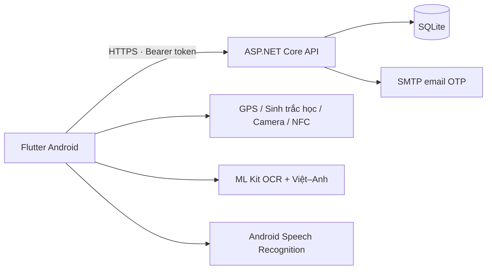
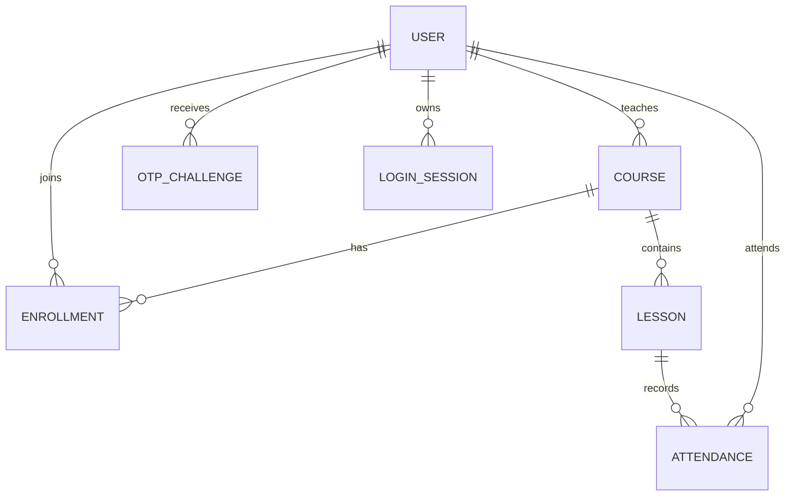
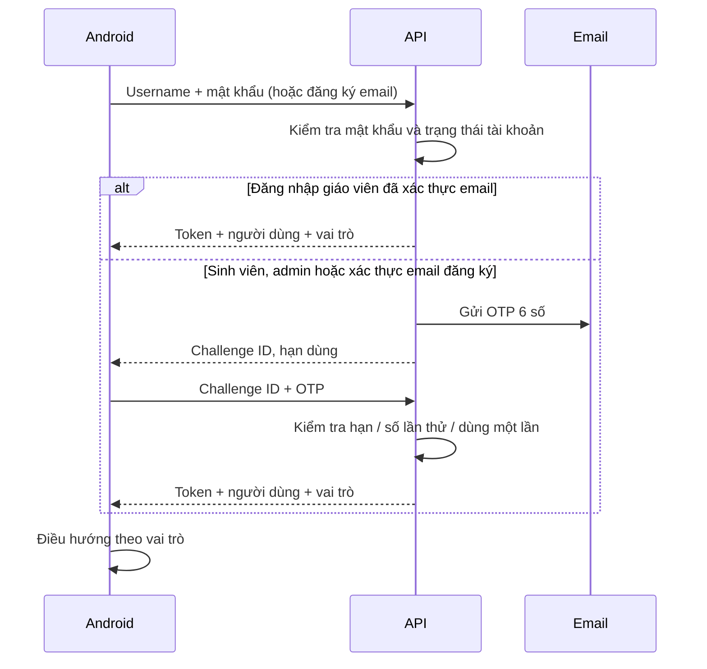

# Kiến trúc Attendly

## Thành phần



Flutter tổ chức theo `api.dart` (HTTP + phiên), `auth_page.dart`, `home_page.dart` (dashboard/CRUD), `report_page.dart` (danh sách lớp/điểm danh), `device_services.dart` và `translation_page.dart`. NFC dùng MethodChannel tới `MainActivity.kt`, không có UID giả hoặc kết quả cảm biến mô phỏng trong ứng dụng.

API chia thành xác thực (`Security.cs`), tài khoản/lớp (`ManagementEndpoints.cs`), buổi học/điểm danh (`AttendanceEndpoints.cs`) và mô hình (`Models.cs`). SQLite có khóa ngoại, chỉ mục duy nhất và xóa dây chuyền cho dữ liệu phụ thuộc. Không cho xóa giáo viên còn phụ trách lớp hoặc tự xóa/hạ quyền admin đang đăng nhập.

## Dữ liệu



Mỗi cặp buổi học–sinh viên chỉ có một điểm danh; mỗi cặp lớp–sinh viên chỉ có một đăng ký. Mật khẩu dùng ASP.NET PasswordHasher (PBKDF2), OTP và token phiên lưu bằng SHA-256; OTP được băm kèm ID yêu cầu. Phiên sống 12 giờ, OTP sống 5 phút và cho thử tối đa 5 lần; đăng nhập sai mật khẩu 5 lần khóa 15 phút. Auth giới hạn 20 yêu cầu/phút/IP. Khi đặt sau proxy, cấu hình Forwarded Headers cho proxy tin cậy trước khi dùng địa chỉ IP để giới hạn.

OTP đúng được tiêu thụ trong transaction trước khi tạo phiên. Client lưu token bằng `flutter_secure_storage`. Máy chủ đọc lại vai trò từ cơ sở dữ liệu với mỗi yêu cầu, không tin vai trò do client gửi.

## Luồng xác thực



## Quyền

| Thao tác | Admin | Giáo viên | Sinh viên |
|---|---|---|---|
| CRUD tài khoản, phân quyền, xem audit | Có | Không | Không |
| CRUD lớp, buổi học | Tất cả | Lớp phụ trách | Không |
| Thêm/xóa danh sách sinh viên | Tất cả | Lớp phụ trách | Không |
| Xem lớp/buổi học | Tất cả | Lớp phụ trách | Lớp đã tham gia |
| CRUD điểm danh thủ công | Tất cả | Lớp phụ trách | Không |
| Tự điểm danh | Không | Không | Lớp đã tham gia |
| Xem điểm danh và GPS | Tất cả | Lớp phụ trách | Bản ghi cá nhân |
| Phiên dịch | Có | Có | Có |

Teacher candidate picker chỉ trả ID, tên và username của sinh viên đã xác thực để thêm vào lớp. Danh sách lớp gửi cho sinh viên không chứa UID NFC; danh sách buổi học không chứa mã QR. Giáo viên không thể chuyển lớp mình cho giáo viên khác; admin thực hiện việc chuyển lớp.

## API

Tiền tố `/api`; nội dung JSON camelCase, lỗi nghiệp vụ `{ "message": "..." }`. Các endpoint bảo vệ yêu cầu header `Authorization: Bearer <token>`. `401` là chưa đăng nhập/phiên hết hạn; `403` thiếu quyền; `409` dữ liệu trùng/xung đột. Các endpoint trả danh sách dùng đường dẫn có `/` cuối như dưới đây.

| Method | Đường dẫn | Mục đích |
|---|---|---|
| POST | `/auth/register` | `{username,email,name,password}` → challenge |
| POST | `/auth/login` | `{username,password}` → phiên `{token,expiresAt,user}` cho giáo viên đã xác thực; challenge OTP cho các tài khoản khác |
| POST | `/auth/verify` | `{challengeId,code}` → token, expiresAt, user |
| GET / POST | `/auth/me` / `/auth/logout` | Đọc người dùng / thu hồi phiên |
| GET / POST | `/users/` | Liệt kê / tạo tài khoản (admin) |
| PUT / DELETE | `/users/{id}` | Sửa / xóa tài khoản (admin) |
| GET / POST | `/courses/` | Lớp được phép xem / tạo lớp |
| PUT / DELETE | `/courses/{id}` | Sửa / xóa lớp |
| GET | `/courses/{id}/students` | Danh sách lớp |
| GET | `/courses/{id}/candidates` | Sinh viên có thể thêm |
| POST | `/courses/{id}/students` | Thêm `{studentId}` |
| DELETE | `/courses/{id}/students/{studentId}` | Xóa khỏi lớp, giữ điểm danh cũ |
| GET / POST | `/lessons/` | Liệt kê / tạo buổi học |
| PUT / DELETE | `/lessons/{id}` | Sửa / xóa buổi học |
| POST | `/lessons/{id}/qr` | Tạo/đổi QR, tối đa 60 giây |
| GET | `/attendance/?lessonId={id}` | Điểm danh được phép xem, lọc buổi tùy chọn |
| POST | `/attendance/check-in` | Sinh viên gửi điểm danh + GPS |
| POST | `/attendance/` | Giáo viên/admin tạo bản ghi thủ công |
| PUT / DELETE | `/attendance/{id}` | Sửa trạng thái/ghi chú hoặc xóa |
| GET | `/audit` | 200 thay đổi gần nhất (admin) |
| GET | `/health` (không có `/api`) | Kiểm tra máy chủ |

Chi tiết payload được định nghĩa trong các record `*Input` ở `server/Attendance.Api/Models.cs`.

Ví dụ điểm danh QR:

```json
{
  "lessonId": "UUID-buoi-hoc",
  "method": "qr",
  "code": "MA-TU-QR-CUA-GIAO-VIEN",
  "nfcTagId": null,
  "latitude": 10.762622,
  "longitude": 106.660172,
  "accuracyMeters": 8,
  "positionTime": "2026-10-21T03:00:00Z"
}
```

Máy chủ kiểm tra danh sách lớp, giờ bắt đầu/kết thúc, trạng thái đóng, vị trí mới tối đa 60 giây (sai lệch đồng hồ tương lai tối đa 10 giây), độ chính xác GPS ≤50 m và khoảng cách Haversine trong bán kính lớp. QR phải khớp mã hiện hành còn hạn; NFC phải khớp UID thẻ được giáo viên gắn với lớp. Sau 15 phút từ lúc bắt đầu, điểm danh tự động được ghi là `late`. Không tự suy diễn `absent`; giáo viên có thể ghi nhận vắng hoặc có phép.

Sinh trắc học hiện là kiểm tra cục bộ trong client; API chỉ có thể xác thực tài khoản, quyền, thời gian, vị trí và trường phương thức. Bản hiện tại chưa có Android Keystore attestation/Play Integrity hay định danh vân tay ở máy chủ. UID NFC và vị trí client không phải bằng chứng chống giả mạo. Đây là ranh giới của bản triển khai, cần thiết kế bổ sung nếu yêu cầu chống gian lận cao.

## Thiết bị và phiên dịch

`local_auth` yêu cầu `FlutterFragmentActivity` và theme AppCompat; ứng dụng dùng xác thực biometric-only. Người dùng từ chối/thiết bị chưa đăng ký sinh trắc học sẽ không được ghi nhận điểm danh qua luồng này. [Tài liệu local_auth](https://pub.dev/packages/local_auth).

NFC sử dụng Android Reader Mode, đọc UID thực, dừng khi ứng dụng vào nền và có timeout 30 giây. QR đọc bằng camera thật với `mobile_scanner`. Không xin vị trí nền.

ML Kit tải mô hình Việt/Anh theo yêu cầu và dịch trên thiết bị. OCR Latin áp dụng cho chữ Việt/Anh trong ảnh; không có nhận diện khuôn mặt. [Tài liệu ML Kit Translation](https://developers.google.com/ml-kit/language/translation), [Text Recognition](https://developers.google.com/ml-kit/vision/text-recognition/v2).

`speech_to_text` trả kết quả từng phần để cập nhật bản dịch, debounce 450 ms. Hệ điều hành có thể dừng nhận khi im lặng; người dùng chạm micro cho đoạn tiếp. Không khẳng định nhận dạng liên tục toàn bài giảng. [Tài liệu speech_to_text](https://pub.dev/packages/speech_to_text).
